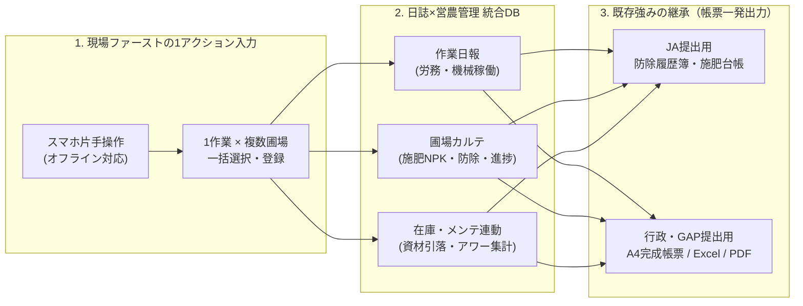
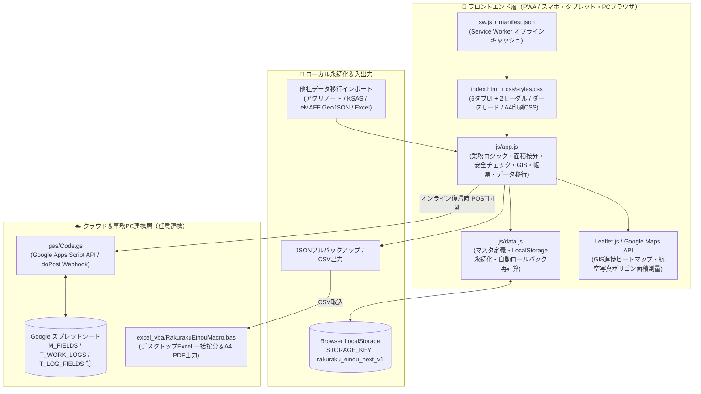
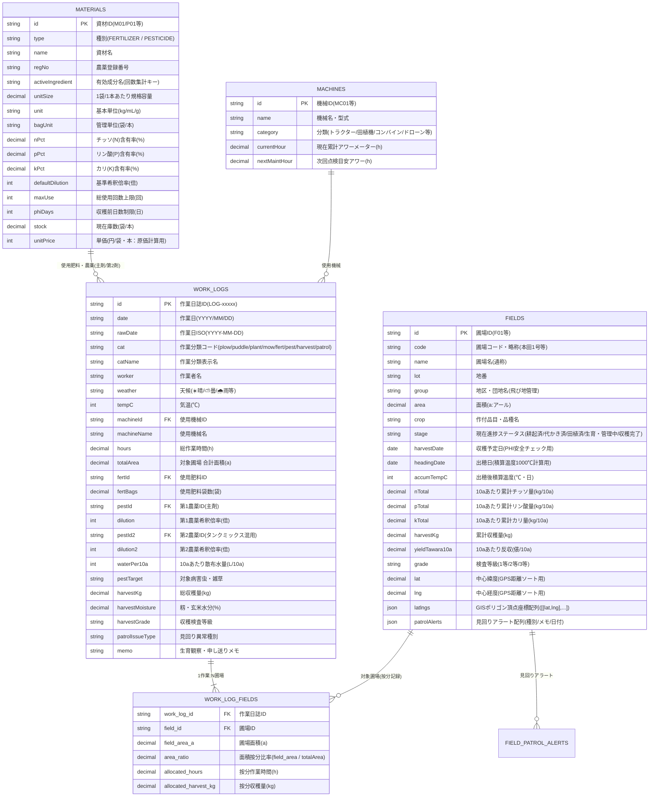

# 次世代版「らくらく営農日誌」要件定義書・DB設計書

本ドキュメントは、株式会社セーブ「らくらく営農日誌」の強みである**実用的なA4完成帳票出力**を継承しつつ、**「作業日報（労務・機械）」と「圃場管理記録（施肥・防除・作業履歴）」の1アクション完全統合**、および**中山間地・飛び地での現場ファーストUI（スマホ片手操作・GIS連携・完全オフライン対応）**を実現するための要件定義およびデータベース（データモデル）設計書です。

---

## 1. システム基本方針（3大コアコンセプト）

1. **「日誌」と「営農管理」の完全統合（1アクション同時記録）**
   - 作業者の日報（誰が・何時間・どの機械で）と、圃場側の記録（どの田んぼに・何を・どれだけ撒いたか）を別々に入力させず、**1回の作業登録トランザクションから両方のデータを自動生成・按分**します。
2. **現場ファーストなUI/UXの徹底（中山間地・飛び地対応）**
   - 航空写真マップ（GIS）やGPS現在地サジェストから点在する複数の田んぼをまとめてタップ選択し、手袋を外した片手操作・電波圏外（完全オフライン）でも数秒で記録を完了できる設計とします。
3. **既存ツールの強み（A4完成帳票作成）の完全継承**
   - 現場スマホで入力されたデータを、JA（防除履歴簿・施肥台帳）・行政・GAP監査用のA4定型フォーマット（PDF / Excel）へワンクリックで流し込み出力し、帰宅後のPC清書・二重入力をゼロにします。

---

## 2. 機能要件一覧（実装済み全機能 ＋ 次期拡張要件）

### 2.1 現場入力・日誌タイムライン・操作性（UI/UX）
| 要件ID | 状態 | 機能名称 | 要件詳細 |
| :--- | :---: | :--- | :--- |
| **UI-01** | ✅ 実装済 | **日誌×圃場 同時完結フロー** | 「作業内容・作業者・時間・使用機械・使用資材」と「対象圃場（複数可）」を1画面で入力し、作業日報と圃場カルテ履歴へ同時反映する。 |
| **UI-02** | ✅ 実装済 | **1作業・複数圃場の一括登録（面積比率按分）** | 草刈り・耕起・施肥・防除・収穫など、同一作業を複数の田んぼで行った際、選択した全圃場へ一括登録し、作業時間・資材使用量・収量を**各圃場の面積比率（`area_ratio`）で自動按分**する。 |
| **UI-03** | ✅ 実装済 | **「前回と同じ」ワンタップ複製** | 直近の作業内容（基肥散布、ドローン防除、昨日の続きの草刈り等）を1タップで呼び出し、対象圃場や数量だけを変えて即座に登録できる。 |
| **UI-04** | ✅ 実装済 | **片手操作・大画面ボタン設計** | 屋外の直射日光下でも視認性が高い高コントラスト配色と、手袋を外して親指だけで操作できる大型タイルボタン・ステッパーUIを採用する。 |
| **UI-05** | ✅ 実装済 | **営農日誌タイムライン（天候・気温・観察メモ・検索）** | 当日の天候・気温・生育観察メモ・引き継ぎ事項を記録し、フリーワード検索や作業分類フィルタで過去の日誌を即座に振り返ることができる。 |
| **UI-06** | ✅ 実装済 | **日誌のインライン編集・取消（自動ロールバック）** | 誤登録した作業日誌を後から編集またはワンタップで取消・削除でき、連動して引き落とされた資材在庫・加算された機械アワー・圃場累計NPKを自動で元に戻す（再計算する）。 |
| **UI-07** | ✅ 実装済 | **収穫・刈取モード（反収・等級・水分量自動按分）** | 収穫した30kg紙袋数・玄米水分量(%)・検査等級（1〜3等）を入力するだけで、総収穫量(kg)と**10aあたり反収（俵/kg）**を自動算出し、複数圃場へ面積按分する。 |

### 2.2 圃場・マップ管理・生育予測（GIS / GPS / Googleマップ連動）
| 要件ID | 状態 | 機能名称 | 要件詳細 |
| :--- | :---: | :--- | :--- |
| **GIS-01** | ✅ 実装済 | **航空写真×動的ポリゴン圃場マップ** | 航空写真・GISキャンバス上に各圃場の区画ポリゴン（新規追加・他社移行圃場を含む全筆）を動的描画し、飛び地や中山間地の田んぼも直感的に識別できるようにする。 |
| **GIS-02** | ✅ 実装済 | **作業進捗ヒートマップ表示** | 選択した作業工程（全体進捗・耕起・草刈り・施肥・防除・収穫）ごとに、各圃場を「未着手（灰）」「一部作業中（黄）」「完了（緑）」で色分け表示する。 |
| **GIS-03** | ✅ 実装済 | **実GPS現在地からの近隣圃場自動サジェスト** | スマホのGPS座標から各圃場までの直線距離(m)を算出し、現在地周辺（半径250m以内または同一団地）の田んぼを動的に自動選択する。 |
| **GIS-04** | ✅ 実装済 | **マップ連動・圃場カルテ表示** | 地図上の圃場をタップすると、地番・面積・作付品種・出穂日・収穫予定日・累計NPK投入量・過去の作業履歴を即座に確認できる。 |
| **GIS-05** | ✅ 実装済 | **Googleマップ（衛星画像）圃場ピッカー＆経路ナビ** | Googleマップの航空写真上でピンをタップして対象圃場を選択・解除でき、選択した複数圃場を回るGoogleマップ経路案内（ナビ）をワンタップで起動できる。 |
| **GIS-06** | ✅ 実装済 | **Googleマップ囲み作図 ＆ 面積自動測量（`㎡`→`a`）** | 新規圃場登録時にGoogleマップ（衛星写真）上で田んぼの四隅をタップして囲むだけで、球面幾何学により面積（`㎡`およびアール`a`）と中心緯度経度を自動測量・入力する。GoogleマップURL貼り付けからの座標抽出にも対応する。 |
| **GIS-07** | ✅ 実装済 | **水稲「出穂後積算温度（1,000℃）」＆刈取適期予測** | 各圃場の出穂日と日平均気温から積算温度（℃）をトラッキングし、1,000℃到達による刈取適期予測日と進捗バーをヒートマップ・カルテに表示する。 |
| **GIS-08** | ✅ 実装済 | **現地見回りメモ＆被害アラート（獣害・水漏れ・雑草）** | 見回り時に発見したイノシシ等の獣害・畦畔水漏れ・雑草・病害虫を1タップでピン留めし、マップや圃場選択タイルに `⚠️` 警告バッジを表示・解決消込できる。 |

### 2.3 農薬・肥料・安全管理（自動計算・混用防除）
| 要件ID | 状態 | 機能名称 | 要件詳細 |
| :--- | :---: | :--- | :--- |
| **SAF-01** | ✅ 実装済 | **希釈倍率・必要薬量の自動逆算電卓** | 対象圃場の合計面積（a）と、10aあたり散布水量・希釈倍率（例：1000倍、ドローン8倍）から、「必要な総水量（L）」と「必要な農薬原液量（mL/g）」を自動逆算する。 |
| **SAF-02** | ✅ 実装済 | **成分量（N・P・K）の自動積算** | 投入した肥料の「袋数」を入力するだけで、肥料マスタの成分含有率（N-P-K %）から**10aあたりおよび圃場全体の正味成分量（kg）**を自動計算し、作期累計を合算する。 |
| **SAF-03** | ✅ 実装済 | **農薬安全基準（使用回数・収穫前日数PHI）チェック** | 農薬マスタの総使用回数上限および収穫前日数制限（`収穫予定日 - 作業日 < phiDays`）をリアルタイム判定し、超過時は警告表示とともに誤登録をブロックする。 |
| **SAF-04** | ✅ 実装済 | **2剤タンクミックス（混用防除）同時計算・在庫連動** | 殺菌剤＋殺虫剤など2種類の農薬を同時に混合散布する際、第1農薬・第2農薬それぞれの必要原液量算出・安全基準判定・在庫引き落としを1回の防除記録で同時処理する。 |
| **SAF-05** | ✅ 実装済 | **有効成分（RAC/成分名）別の延べ使用回数カウント** | 商品名が異なっても同一の有効成分を含む農薬が散布された場合、成分単位での延べ使用回数を合算して上限超過をチェックする。 |

### 2.4 機械・資材・マスタ管理・圃場別採算分析
| 要件ID | 状態 | 機能名称 | 要件詳細 |
| :--- | :---: | :--- | :--- |
| **RES-01** | ✅ 実装済 | **機械稼働時間集計・点検アラート・整備リセット** | 日誌の作業時間から各農機の累計稼働時間を自動集計し、点検閾値（残り10h以内）で警告を表示。「オイル交換・点検完了」ボタンで次回点検目安をワンタップ更新する。 |
| **RES-02** | ✅ 実装済 | **資材（肥料・農薬）の在庫自動引落・入庫補充** | 作業日誌で記録した農薬・肥料の使用量を現在庫から自動引き落とし、発注点割れを警告。追加購入時は「＋入庫」ボタンで即座に在庫補充できる。 |
| **RES-03** | ✅ 実装済 | **作業者別の労務・作業時間集計** | 作業者ごとの日別・作業分類別の労働時間および圃場別の面積按分労働時間を自動集計する。 |
| **RES-04** | ✅ 実装済 | **農機具・肥料・農薬・圃場マスタの追加・削除（CRUD）** | 現場画面（タブ3・タブ5）からいつでも新しい農機具、肥料銘柄（NPK比率・単価）、農薬（登録番号・有効成分・PHI・単価）、圃場を追加・削除できる。 |
| **RES-05** | ✅ 実装済 | **圃場別「10aあたり原価・粗利・採算ランク（S〜C）」試算** | 各圃場に投入した肥料費・農薬費・労務費・機械償却燃料費と収穫反収から、10aあたりの売上・原価・粗利益・採算ランク（S/A/B/C）を自動試算する（米価・時給シミュレーション対応）。 |

### 2.5 帳票・データ移行・システム環境・バックアップ
| 要件ID | 状態 | 機能名称 | 要件詳細 |
| :--- | :---: | :--- | :--- |
| **OUT-01** | ✅ 実装済 | **JA・行政・GAP提出用 A4完成帳票出力（4様式）** | ①JA提出用「生産履歴記帳簿（施肥・防除台帳）」、②行政・法人用「作業日報・面積按分表」、③経営・GAP用「圃場別 反収×NPK×労働時間 総括表」、④「圃場別 10a採算・粗利試算表」をA4横レイアウトで一発印刷・PDF保存・CSV出力する。 |
| **OUT-02** | ✅ 実装済 | **品種別・団地別フィルタ ＆ 面積加重平均NPK集計** | JA提出帳票において対象品種・団地・個別圃場での絞り込みに対応し、複数回に分けて施肥した場合も面積加重平均により正確な10aあたり累計NPK成分量を算出する。 |
| **OUT-03** | ✅ 実装済 | **Googleスプレッドシート×GAS ＆ Excel VBA 双方向連携** | GASによる1クリック初期シート構築・未処理ログ自動按分・A4 PDF出力、およびデスクトップExcel VBAマクロ（`M_圃場マスタ`連動按分）による既存Excel環境との完全互換を提供する。 |
| **SYS-01** | ✅ 実装済 | **完全オフライン駆動（PWA）＆ クラウド同期** | Service WorkerとLocalStorage永続化により電波圏外の山間部でも100%動作し、オンライン復帰時にGASウェブアプリへ未同期日誌・新規圃場を一括送信する。 |
| **SYS-02** | ✅ 実装済 | **他社営農アプリ・eMAFF筆ポリゴン スマートデータ移行** | アグリノート、クボタKSAS、農水省eMAFF農地ナビ（GeoJSON）、既存Excel台帳のファイルを読み込み、列名の違いや面積単位（`㎡`・`ha`・`反` → `a`）を自動判別・換算して一括インポートする。 |
| **SYS-03** | ✅ 実装済 | **JSONフルバックアップ＆1クリック復元・アプリ内説明書** | 端末内の全データをJSONファイルとして出力・復元できるほか、オフラインでも閲覧可能な「📖 使い方・説明書」モーダルを内蔵する。 |

### 2.6 【Phase 2 拡張要件】高度データ解析・気象連携・AI診断（`TSK-036`〜`TSK-040`）
| 要件ID | 状態 | 機能名称 | 要件詳細 |
| :--- | :---: | :--- | :--- |
| **ANA-01** | 🚀 計画中 | **チッソ(N)施肥量×反収の二次曲線回帰（最適施肥算出）** | 最小二乗法による二次関数回帰（$y = ax^2 + bx + c$）で収穫逓減カーブを描画し、反収・粗利が最大となるピークの最適チッソ施肥量を自動算出する（`TSK-036`）。 |
| **ANA-02** | 🚀 計画中 | **全圃場4象限ポートフォリオ解析（バブルチャート）** | 「10aあたり作業時間」×「10aあたり粗利益」×「面積バブル」の4象限マトリクスにより、全圃場を「🌟優良主力田 / 🔧改善余地田 / 💦労力過多田 / ⚠️要見直し田」に自動分類する（`TSK-037`）。 |
| **ANA-03** | 🚀 計画中 | **気象API自動連携 ＆ 高温障害・病害虫予察アラート** | Open-Meteo APIから気温・雨量・風速を取得し、出穂後20日間の高温登熟障害リスク、いもち病・カメムシ予察、ドローン防除可否（風速4m/s判定）を自動通知する（`TSK-038`）。 |
| **ANA-04** | 🚀 計画中 | **AI営農アドバイザー ＆ 次週優先ToDo提案・音声入力** | 日誌メモ・見回りアラート・積算温度から次週優先すべき作業を自動提案し、Web Speech APIによる音声入力文字起こしを支援する（`TSK-039`）。 |
| **ANA-05** | 🚀 計画中 | **月別・旬別「労働時間＆コスト構造」パレート分析** | 作業分類別の工数・コストを累積構成比（パレート図）で可視化し、経営を圧迫している上位ボトルネック作業の削減インパクトを試算する（`TSK-040`）。 |

---

## 3. 基本設計①：システム全体アーキテクチャ・モジュール構成設計

本システムは、**「山間部・圏外の現場でも100%即応するオフラインファーストPWA」** を中核とし、**「Googleスプレッドシート / GASクラウド基盤」** および **「事務PC用Excelマクロ版」** のハイブリッド三層構成を採用しています。

### 3.1 ファイル・モジュール構成一覧

| レイヤー | ファイルパス | 役割・主な責務 |
| :--- | :--- | :--- |
| **View (HTML)** | `index.html` | 全5タブ（現場一括入力・GISマップ・機械/資材・A4帳票・設定/データ移行）および2モーダル（Googleマップ囲み作図・操作マニュアル）のDOM構造定義 |
| **Style (CSS)** | `css/styles.css` | ライト/ダークテーマ変数定義、スマホ片手操作ボトムナビ、GISポリゴン描画スタイル、A4横向き印刷専用 `@media print` 制御 |
| **Model / State** | `js/data.js` | 初期マスタ定義、`localStorage` 保存・読込（`saveAppState` / `loadAppState`）、日誌編集・削除時の全圃場ステータス＆NPK累計自動ロールバック再計算（`recalculateFieldAggregatesFromLogs`） |
| **Controller / Logic** | `js/app.js` | 1アクション複数圃場按分、2剤タンクミックス逆算、農薬回数・PHIチェック、積算温度予測、見回りアラート、10a採算ランク試算、A4帳票4様式描画、他社データ自動マッピング移行 |
| **PWA基盤** | `sw.js`, `manifest.json` | オフライン時のHTML/CSS/JS/アセットキャッシュ応答、ホーム画面インストール定義 |
| **Cloud Backend** | `gas/Code.gs` | Googleスプレッドシート11シート自動構築（`setupAllSheets`）、未処理日誌の面積按分展開（`processPendingLogs`）、A4帳票生成・PDF出力、Webアプリ `doPost(e)` 受信 |
| **Desktop Excel** | `excel_vba/RakurakuEinouMacro.bas` | RFC4180準拠CSVパーサー、`M_圃場マスタ` 連携による複数圃場自動按分転記（`AllocateMultiFieldLogs`）、A4横1ページPDF出力 |

---

## 4. 基本設計②：画面構成・画面遷移設計（全5タブ＋2モーダル）

現場作業者の「親指1本での即入力」と、事務・経営者の「一発帳票出力・採算分析」を両立するため、下部ナビゲーションバー（PCでは上部タブ）による**5画面切り替え＋2モーダル構成**としています。

| 画面ID | 画面名 | 主な機能・UIコンポーネント | 主要関数（`js/app.js`） |
| :--- | :--- | :--- | :--- |
| **`tab-input`** | **① 現場一括入力＆営農日誌** | ・作業分類選択（耕起/代かき/田植/草刈/基肥/追肥/防除/収穫/水管理・見回り） ・「⚡前回と同じ作業・圃場をセット」ワンタップ呼出 ・天候・気温・生育観察メモ入力 ・団地別フィルタ＆GPS近접ソート付き複数圃場マルチセレクト ・施肥NPK自動計算 / 防除2剤タンクミックス希釈逆算＆PHI・回数警告 / 収穫水分・等級・反収自動換算 ・作業日誌タイムライン（キーワード検索・その場編集・取消ロールバック） | `selectWorkCat()`, `applyLastPreset()`, `recalcAll()`, `submitWorkLog()`, `editWorkLog()`, `deleteWorkLog()`, `renderDailyJournalTimeline()` |
| **`tab-gis`** | **② GIS圃場マップ・積算温度・カルテ** | ・進捗カラーリング切替（作業進捗 / 品種別 / 積算温度・刈取適期） ・水稲「出穂後積算温度（1,000℃）」プログレスバー＆刈取適期予測リスト ・Leaflet航空写真ポリゴンマップ＆SVG概念マップ切替 ・圃場タップ時の詳細カルテドロワー（基本情報・累計NPK・見回りアラート追加/解消・作業履歴一覧） | `setMapMode()`, `renderGisSubViews()`, `initRealLeafletMap()`, `openFieldDrawer()`, `addFieldPatrolAlert()`, `resolveFieldPatrolAlert()` |
| **`tab-resource`** | **③ 機械アワー・資材在庫・マスタ管理** | ・農機具稼働時間＆次回オイル交換までの残り時間プログレスバー ・「🔧点検・オイル交換実施」ワンタップリセット ・肥料・農薬の現在庫数一覧＆ワンタップ「＋入庫補充」 ・農機具・肥料・農薬マスタの新規追加フォーム＆削除機能 | `renderMachines()`, `completeMaintenance()`, `renderMaterials()`, `replenishMaterialStock()`, `addNewMachine()`, `addNewMaterial()` |
| **`tab-report`** | **④ A4完成帳票出力（全4様式）** | ・**様式1 (`ja`)**: JA提出用 生産履歴記帳簿（施肥・防除履歴・有効成分別回数集計） ・**様式2 (`daily`)**: 作業日報・労務機械稼働集計表 ・**様式3 (`yield`)**: 圃場別 収穫高・反収（俵/10a）＆累計NPK総括表 ・**様式4 (`cost`)**: 圃場別 10aあたり原価・粗利・採算ランク（S/A/B/C）試算表 ・対象品種/団地フィルタ、A4印刷/PDF出力、CSVダウンロード | `switchReportType()`, `renderReportPreview()`, `exportCSV()` |
| **`tab-settings`** | **⑤ 設定・データ移行・圃場作図登録** | ・他社データ移行ウィザード（アグリノート / KSAS / eMAFF農地ナビGeoJSON / 既存Excel） ・新規圃場マスタ登録フォーム（手入力＋Googleマップ衛星写真ポリゴン作図・面積自動測量） ・GASクラウド同期URL設定＆手動同期実行 ・JSONフルバックアップ保存・復元・初期デモデータリセット | `loadMigrationSample()`, `executeMigrationImport()`, `addNewFieldFromSettings()`, `syncPendingLogsToGas()`, `exportFullBackupJson()` |
| **`googleMapPickerModal`** | **モーダル①：Googleマップ圃場ポリゴン作図** | ・衛星写真（ハイブリッド）上で圃場の角をタップして多角形を描画 ・球面幾何学計算により面積（`㎡` → `a`）と中心緯度経度を自動算出してフォームへ反映 | `openGoogleMapFieldPicker()`, `recalcPickerPolygonGeometry()`, `applyPickedMapGeometry()` |
| **`userManualModal`** | **モーダル②：アプリ内操作マニュアル** | ・ヘッダーの「📖 使い方」ボタンからいつでも参照できる現場・事務向けクイックガイド | `toggleUserManualModal()` |

---

## 5. 基本設計③：統合データモデル設計（ER図・最新スキーマ）

**「1回の入力で、作業日報と複数圃場の履歴・NPK計算・2剤防除・収穫反収・在庫引落・機械稼働を同時に完結させる」** ため、親テーブルである `WORK_LOGS`（作業日誌ヘッダ）に対し、対象圃場の中間配列/テーブル `WORK_LOG_FIELDS` を紐付け、**面積比率（`area_ratio`）によって作業時間や資材投入量を各圃場へ自動按分する**構造を採ります。

---

## 6. 基本設計④：コア計算・業務アルゴリズム仕様

### 6.1 面積比率按分（`area_ratio`）と面積加重平均NPK計算ロジック
現場で複数圃場 $F_1, F_2, \dots, F_k$（各面積 $A_i\text{ [a]}$）を選択して一括登録した場合、以下の数式で各圃場へ自動按分します。

1. **選択圃場の合計面積**:
   $$A_{\text{total}} = \sum_{i=1}^{k} A_i \quad [\text{a}]$$
2. **各圃場の面積按分比率（`area_ratio`）**:
   $$r_i = \frac{A_i}{A_{\text{total}}}$$
3. **10aあたり施用量・成分量（JA提出用・各圃場への加算値）**:
   - 肥料1袋あたり重量 $W_{\text{bag}}\text{ [kg]}$、使用合計袋数 $B\text{ [袋]}$、成分含有率 $N_{\%}, P_{\%}, K_{\%}$ のとき：
   $$\text{総施肥重量 } W_{\text{total}} = B \times W_{\text{bag}} \quad [\text{kg}]$$
   $$\text{10aあたり施肥量 } w_{10\text{a}} = \frac{W_{\text{total}}}{A_{\text{total}} / 10} \quad [\text{kg/10a}]$$
   $$\Delta N_{10\text{a}} = w_{10\text{a}} \times \frac{N_{\%}}{100}, \quad \Delta P_{10\text{a}} = w_{10\text{a}} \times \frac{P_{\%}}{100}, \quad \Delta K_{10\text{a}} = w_{10\text{a}} \times \frac{K_{\%}}{100} \quad [\text{kg/10a}]$$
4. **複数圃場選択時の「面積加重平均」表示（A4帳票ヘッダ等）**:
   $$N_{\text{weighted}} = \frac{\sum_{i=1}^{k} \left( N_{\text{total}, i} \times A_i \right)}{A_{\text{total}}}$$

---

### 6.2 防除2剤タンクミックス逆算 ＆ 有効成分回数・PHI安全基準判定ロジック
1. **総散布水量（L）**:
   $$V_{\text{water}} = \frac{A_{\text{total}}}{10} \times v_{10\text{a}} \quad [\text{L}] \quad (\text{※ドローン防除時は } v_{10\text{a}} \approx 1\text{〜}8\text{ L/10a}, \text{ 動噴は } 100\text{ L/10a})$$
2. **主剤（第1農薬）および混用剤（第2農薬）の必要原液量（mL または g）**:
   $$Q_{\text{pest}, 1} = \frac{V_{\text{water}} \times 1000}{D_1}, \quad Q_{\text{pest}, 2} = \frac{V_{\text{water}} \times 1000}{D_2}$$
3. **リアルタイム安全基準チェック（主剤・第2剤それぞれに対して検証）**:
   - **有効成分別（および製品別）累積回数チェック**:
     選択された各圃場 $F_i$ について、過去の防除履歴（主剤・第2剤の両方を含む）での同一製品使用回数 $C_{\text{prod}}(F_i)$ および同一有効成分（`activeIngredient`）使用回数 $C_{\text{ai}}(F_i)$ を集計し、
     $$\max\left(C_{\text{prod}}(F_i), C_{\text{ai}}(F_i)\right) + 1 > \text{maxUse} \implies \text{🚨 使用回数超過警告}$$
   - **収穫前日数（PHI: Pre-Harvest Interval）チェック**:
     $$\text{harvestDate}(F_i) - \text{workDate} < \text{phiDays} \implies \text{🚨 収穫前日数(PHI)違反警告}$$

---

### 6.3 日誌編集・取消時の自動ロールバック再計算アルゴリズム（`recalculateFieldAggregatesFromLogs`）
日誌の事後編集（`editWorkLog`）や削除（`deleteWorkLog`）を行ってもデータの整合性が絶対に崩れないよう、更新時は全圃場の集計値をベース値にリセットした上で、時系列順（古い順）に全作業日誌を再評価（イベントソーシング方式）します。

1. 全圃場の `nTotal`, `pTotal`, `kTotal`, `harvestKg`, `yieldTawara10a`, `pestHistory` を初期化。
2. `workLogs` を日付昇順で走査し、対象圃場ごとに：
   - 作業分類に応じた進捗ステージ（`耕起済` → `代かき済` → `田植済` → `生育・管理中` → `収穫完了`）を更新。
   - `cat === 'fert'` の場合、$\Delta N_{10\text{a}}, \Delta P_{10\text{a}}, \Delta K_{10\text{a}}$ を再加算。
   - `cat === 'pest'` の場合、主剤および第2剤の散布履歴を各圃場の `pestHistory` に再構築。
   - `cat === 'harvest'` の場合、面積比率 $r_i$ で按分した収穫量 $\text{harvestKg}_i$ と反収 $\text{yieldTawara10a}_i = \frac{\text{harvestKg}_i / 60}{A_i / 10}$ を再算出。

---

### 6.4 Googleマップ球面幾何学ポリゴン面積自動測量アルゴリズム
設定タブの「Googleマップ衛星写真で圃場を囲んで面積・座標を自動取得」では、地球楕円体（半径 $R = 6,378,137\text{ m}$）上の頂点列 $(\phi_i, \lambda_i)$ から球面過剰（Spherical Excess）または平面投影近似により面積 $S\text{ [m}^2\text{]}$ を算出し、アール単位へ自動変換します。

$$\text{圃場面積 } A\text{ [a]} = \text{round}\left( \frac{S\text{ [m}^2\text{]}}{100}, 1 \right)$$

---

### 6.5 水稲「出穂後積算温度（1,000℃）」刈取適期予測ロジック
水稲（コシヒカリ等）の登熟目安である出穂後積算温度 $T_{\text{target}} = 1,000\text{ ℃・日}$ に対し、現在の積算温度 $T_{\text{accum}}$ と日平均気温 $\bar{T}_{\text{daily}}$（デフォルト $24.5\text{ ℃}$、日誌の気温記録と連動）から残り日数を算出します。

$$\text{刈取適期までの予測残日数 } D_{\text{remain}} = \max\left(0, \left\lceil \frac{1000 - T_{\text{accum}}}{\bar{T}_{\text{daily}}} \right\rceil \right)$$
- $T_{\text{accum}} \ge 920\text{ ℃}$: **🟠 刈取適期（920〜1,050℃）** バッジ点灯
- $T_{\text{accum}} \ge 1,050\text{ ℃}$: **🔴 刈取遅れ注意（胴割れリスク）** アラート点灯

---

### 6.6 圃場別「10aあたり原価・粗利・採算ランク（S/A/B/C）」算出ロジック
A4帳票の様式4（`cost`：圃場別10aあたり採算試算表）では、各圃場 $F_i$ への按分実績から10aあたりの収益性を自動評価します。

1. **10aあたり売上高**: $\text{Rev}_{10\text{a}} = \text{反収(俵/10a)} \times \text{米価単価(円/60kg俵)}$（1等米基準 18,500円/俵）
2. **10aあたり生産原価**:
   $$\text{Cost}_{10\text{a}} = \underbrace{\text{按分肥料費}_{10\text{a}}}_{\text{袋数}\times\text{単価}} + \underbrace{\text{按分農薬費}_{10\text{a}}}_{\text{薬量}\times\text{単価}} + \underbrace{\text{按分労務費}_{10\text{a}}}_{\text{時間}\times 1,800\text{円/h}} + \underbrace{\text{按分機械燃料償却費}_{10\text{a}}}_{\text{機械時間}\times 2,200\text{円/h}}$$
3. **10aあたり粗利益および採算ランク判定**:
   $$\text{Profit}_{10\text{a}} = \text{Rev}_{10\text{a}} - \text{Cost}_{10\text{a}}$$
   - **Sランク（優良）**: $\text{Profit}_{10\text{a}} \ge 90,000\text{ 円/10a}$
   - **Aランク（良好）**: $70,000 \le \text{Profit}_{10\text{a}} < 90,000\text{ 円/10a}$
   - **Bランク（標準）**: $45,000 \le \text{Profit}_{10\text{a}} < 70,000\text{ 円/10a}$
   - **Cランク（要改善）**: $\text{Profit}_{10\text{a}} < 45,000\text{ 円/10a}$

---

## 7. 基本設計⑤：外部インターフェース・帳票出力マッピング仕様

### 7.1 A4完成帳票出力（全4様式）マッピング仕様

| 様式コード | 帳票タイトル | 提出先・用途 | 主な自動印字項目 |
| :--- | :--- | :--- | :--- |
| **`ja`** | **JA提出用：生産履歴記帳簿（施肥・防除履歴）** | JA（農協）・特別栽培米検査・JGAP審査 | 生産者情報、品種名、対象地番一覧、合計面積(a)、種子消毒履歴、**施肥履歴**（日付・肥料名・10a施用量・10aあたりN/P/K成分量）、**防除履歴**（日付・農薬名・登録番号・有効成分・対象病害虫・希釈倍率・10a使用量・使用回数・PHI判定）、**有効成分別カウント集計表** |
| **`daily`** | **作業日報・労務機械稼働集計表** | 農業法人労務管理・税무申告・補助金実績報告 | 作業日、天候・気温、作業分類、作業者名、対象圃場（複数表記）、合計面積(a)、作業時間(h)、使用機械名、使用資材・収穫量・観察メモ摘要 |
| **`yield`** | **圃場別 収穫高・反収・NPK投入総括表** | 次年度施肥設計・地主への収量報告 | 圃場コード、圃場名、団地、面積(a)、品種、出穂日・積算温度、10a累計N-P-K(kg)、総収穫量(kg)、**10aあたり反収(俵/10a)**、検査等級 |
| **`cost`** | **圃場別 10aあたり原価・粗利・採算試算表** | 経営改善・不採算圃場の条件見直し | 圃場名、面積(a)、10a作業時間(h)、肥料費/10a、農薬費/10a、労務機械費/10a、**10a合計原価**、10a売上高、**10a粗利益**、**採算ランク（S/A/B/C）** |

### 7.2 他社営農アプリ・行政データ移行インターフェース仕様

| 移行元システム | 取込フォーマット | 自動認識・正規化変換ルール（`executeMigrationImport`） |
| :--- | :--- | :--- |
| **アグリノート (AgriNote)** | CSV / TSV | `圃場名`, `面積(a)`, `作付品種`, `作業日`, `作業項目`, `肥料名/農薬名`, `使用量` カラムを自動検出し、`M_FIELDS` および `T_WORK_LOGS` へ一括変換・面積按分登録 |
| **クボタ KSAS** | CSV / TSV | KSAS特有の `ほ場ID`, `ほ場名`, `面積(㎡またはa)`, `作業時間`, `乾燥前重量/玄米重(kg)`, `水分(%)` を自動検出し、㎡→a換算および圃場別反収データへ自動変換 |
| **農水省 eMAFF農地ナビ** | GeoJSON (`FeatureCollection`) | 筆ポリゴンの `coordinates`（経度・緯度配列）を `[lat, lng]` へ変換し、重心座標の算出および球面面積測量（`㎡` → `a`）を行ってGISマップへ即座に描画登録 |
| **既存らくらく営農日誌 / Excel** | CSV / TSV（コピペ対応） | タブ区切りまたはカンマ区切りの圃場一覧・作業履歴を自動判別し、未登録圃場・未登録資材があればマスタへ自動追加した上で履歴を取り込む |

