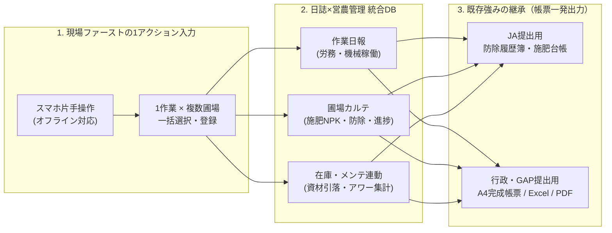

# 次世代版「らくらく営農日誌」要件定義書・DB設計書

本ドキュメントは、株式会社セーブ「らくらく営農日誌」の強みである**実用的なA4完成帳票出力**を継承しつつ、**「作業日報（労務・機械）」と「圃場管理記録（施肥・防除・作業履歴）」の1アクション完全統合**、および**中山間地・飛び地での現場ファーストUI（スマホ片手操作・GIS連携・完全オフライン対応）**を実現するための要件定義およびデータベース（データモデル）設計書です。

---

## 1. システム基本方針（3大コアコンセプト）

1. **「日誌」と「営農管理」の完全統合（1アクション同時記録）**
   - 作業者の日報（誰が・何時間・どの機械で）と、圃場側の記録（どの田んぼに・何を・どれだけ撒いたか）を別々に入力させず、**1回の作業登録トランザクションから両方のデータを自動生成・按分**します。
2. **現場ファーストなUI/UXの徹底（中山間地・飛び地対応）**
   - 航空写真マップ（GIS）やGPS現在地サジェストから点在する複数の田んぼをまとめてタップ選択し、手袋を外した片手操作・電波圏外（完全オフライン）でも数秒で記録を完了できる設計とします。
3. **既存ツールの強み（A4完成帳票作成）の完全継承**
   - 現場スマホで入力されたデータを、JA（防除履歴簿・施肥台帳）・行政・GAP監査用のA4定型フォーマット（PDF / Excel）へワンクリックで流し込み出力し、帰宅後のPC清書・二重入力をゼロにします。

---

## 2. 機能要件一覧

### 2.1 現場入力・操作性（UI/UX）
| 要件ID | 機能名称 | 要件詳細 |
| :--- | :--- | :--- |
| **UI-01** | **日誌×圃場 同時完結フロー** | 「作業内容・作業者・時間・使用機械・使用資材」と「対象圃場（複数可）」を1画面（またはステップUI）で入力し、日報と圃場履歴へ同時反映する。 |
| **UI-02** | **1作業・複数圃場の一括登録** | 草刈り・耕起・基肥散布など、同一作業を複数の田んぼで行った際、選択した全圃場へ一括で履歴を登録する。作業時間や資材使用量は**各圃場の面積比率で自動按分**（または均等割・個別微調整）する。 |
| **UI-03** | **「前回と同じ」ワンタップ複製** | 直近の作業内容（昨日の続きの草刈り、同じレシピの防除など）を1タップで呼び出し、対象圃場だけを変えて即座に登録できる。 |
| **UI-04** | **片手操作・大画面ボタン設計** | 屋外の直射日光下でも視認性が高い高コントラスト配色と、親指だけで操作できる大型タイルボタン・テンキーUIを採用する。 |

### 2.2 圃場・マップ管理（GIS / GPS）
| 要件ID | 機能名称 | 要件詳細 |
| :--- | :--- | :--- |
| **GIS-01** | **航空写真×ポリゴン圃場マップ** | 航空写真上に各圃場の区画（ポリゴンまたはピン）を表示し、飛び地や中山間地の小さな田んぼも直感的に識別できるようにする。 |
| **GIS-02** | **作業進捗ヒートマップ表示** | 選択した作業工程（耕起・代かき・田植え・草刈り・防除・収穫など）ごとに、各圃場を「未着手（灰）」「作業中（黄）」「完了（緑）」で色分け表示する。 |
| **GIS-03** | **GPS現在地からの圃場自動サジェスト** | スマホのGPS座標から現在いる（または半径50m以内の）圃場を自動判定し、入力画面の先頭にサジェスト表示する。 |
| **GIS-04** | **マップ連動・圃場カルテ表示** | 地図上の圃場をタップすると、その圃場の基本情報（地番・面積・作付品種）と過去の作業・施肥・防除履歴、累計NPK投入量を即座に確認できる。 |

### 2.3 農薬・肥料・安全管理（自動計算）
| 要件ID | 機能名称 | 要件詳細 |
| :--- | :--- | :--- |
| **SAF-01** | **希釈倍率・必要薬量の自動逆算電卓** | 対象圃場の合計面積（a/10a）と、10aあたり散布水量・希釈倍率（例：1000倍）から、「必要な総水量（L）」と「必要な農薬原液量（mL/g）」を自動逆算する。 |
| **SAF-02** | **成分量（N・P・K）の自動積算** | 投入した肥料の「袋数（またはkg）」を入力するだけで、肥料マスタの成分含有率（N-P-K %）から**10aあたりおよび圃場全体の正味成分量（kg）**を自動計算し、作期累計を合算する。 |
| **SAF-03** | **農薬安全基準（使用回数・収穫前日数）チェック** | 農薬マスタの基準値（総使用回数上限、収穫前日数上限）と対象圃場の履歴・収穫予定日を照合し、基準超過リスクがある場合は登録前に警告アラートを表示する。 |

### 2.4 機械・資材・労務連動
| 要件ID | 機能名称 | 要件詳細 |
| :--- | :--- | :--- |
| **RES-01** | **機械稼働時間集計・メンテアラート** | 日誌の作業時間（または終了時アワーメーター入力）から各農機の累計稼働時間を自動集計し、オイル交換や定期点検の閾値（例：100時間ごと）に達した際にアラートを通知する。 |
| **RES-02** | **資材（肥料・農薬）の在庫自動引落** | 作業日誌で記録した農薬・肥料の使用量を、資材在庫テーブルから自動で引き落とし、発注点（安全在庫）を下回った資材を可視化する。 |
| **RES-03** | **作業者別の労務・作業時間集計** | 作業者ごとの日別・月別・作業分類別の労働時間およびオペレーター稼働時間を自動集計する。 |

### 2.5 帳票・データ連携・オフライン環境
| 要件ID | 機能名称 | 要件詳細 |
| :--- | :--- | :--- |
| **OUT-01** | **JA・行政・GAP提出用A4帳票出力** | 圃場別・品種別の「防除履歴簿」「施肥台帳」「作業日報」「機械点検記録簿」を、既存のA4提出レイアウトそのままにPDF/Excelでワンクリック出力する。 |
| **OUT-02** | **既存Excelテンプレート流し込み・CSV連携** | 既存の「らくらく営農日誌」ExcelシートやJA指定フォーマットへ直接流し込めるCSV/Excelエクスポート機能を提供する。 |
| **SYS-01** | **完全オフライン駆動＆自動同期** | 電波の届かない山間部でもマップ閲覧・履歴参照・日誌入力が100%動作し、電波復帰時にバックグラウンドでクラウドDBへ自動同期する。 |

---

## 3. 統合データモデル設計（ER図）

**「1回の入力で、作業日報と複数圃場の履歴・NPK計算・在庫引落・機械稼働を同時に完結させる」** ため、親テーブルである `WORK_LOGS`（作業日誌ヘッダ）に対し、対象圃場の中間テーブル `WORK_LOG_FIELDS` を紐付け、**面積比率（`area_ratio`）によって作業時間や資材投入量を各圃場へ自動按分する**構造を採ります。

```mermaid
erDiagram
    CROPS_PLANS ||--o{ FIELDS_CROP_YEAR : "作付計画"
    FIELDS ||--o{ FIELDS_CROP_YEAR : "年度別作付"
    FIELDS ||--o{ WORK_LOG_FIELDS : "対象圃場(按分記録)"
    
    WORK_LOGS ||--|{ WORK_LOG_FIELDS : "1作業:N圃場"
    WORK_LOGS ||--|{ WORK_LOG_WORKERS : "参加作業者"
    WORK_LOGS ||--o{ WORK_LOG_MACHINES : "使用機械"
    WORK_LOGS ||--o{ WORK_LOG_MATERIALS : "使用農薬・肥料"

    WORKERS ||--o{ WORK_LOG_WORKERS : "労務記録"
    MACHINES ||--o{ WORK_LOG_MACHINES : "稼働記録"
    MACHINES ||--o{ MACHINE_MAINTENANCE : "点検・整備履歴"
    MATERIALS ||--o{ WORK_LOG_MATERIALS : "資材消費"
    MATERIALS ||--o{ MATERIAL_INVENTORY_TX : "入出庫履歴"
    WORK_CATEGORIES ||--o{ WORK_LOGS : "作業種別"

    FIELDS {
        string field_id PK "圃場ID"
        string field_code "圃場番号・略称"
        string field_name "圃場名(通称)"
        string address_lot "地番"
        string area_group "地区・団地名(飛び地管理)"
        decimal area_a "面積(a:アール)"
        json polygon_geojson "GISポリゴン座標"
        decimal center_lat "中心緯度(GPS判定用)"
        decimal center_lng "中心経度(GPS判定用)"
    }

    FIELDS_CROP_YEAR {
        string field_crop_id PK "年度圃場作付ID"
        int crop_year "作付年度(例:2027)"
        string field_id FK "圃場ID"
        string crop_id FK "品目・品種ID"
        date planned_harvest_date "収穫予定日(農薬安全チェック用)"
        string current_stage "現在ステータス(耕起済/代かき済/田植済等)"
    }

    WORK_LOGS {
        string work_log_id PK "作業日誌ID(UUID)"
        date work_date "作業日"
        string work_category_id FK "作業分類ID(耕起/防除/施肥/草刈等)"
        time start_time "開始時刻"
        time end_time "終了時刻"
        decimal total_duration_hr "総作業時間(h)"
        decimal total_area_a "対象圃場 合計面積(a)"
        string weather "天候"
        string notes "特記事項・メモ"
        string sync_status "同期状態(LOCAL/SYNCED)"
    }

    WORK_LOG_FIELDS {
        string log_field_id PK "日誌×圃場明細ID"
        string work_log_id FK "作業日誌ID"
        string field_id FK "圃場ID"
        decimal field_area_a "圃場面積(a)"
        decimal area_ratio "面積按分比率(field_area / total_area)"
        decimal allocated_duration_hr "按分作業時間(h)"
        string stage_updated_to "更新後進捗ステータス"
    }

    WORK_LOG_MATERIALS {
        string log_material_id PK "使用資材明細ID"
        string work_log_id FK "作業日誌ID"
        string material_id FK "資材ID(農薬/肥料)"
        string input_unit "入力単位(袋/kg/L/mL)"
        decimal total_input_qty "総使用量(入力値)"
        decimal total_weight_kg_or_l "総正味量(kgまたはL換算)"
        int dilution_rate "希釈倍率(防除時:例1000)"
        decimal water_volume_l "総散布水量(L)"
        decimal calc_n_total_kg "総チッソ(N)投入量(kg)"
        decimal calc_p_total_kg "総リン酸(P)投入量(kg)"
        decimal calc_k_total_kg "総カリ(K)投入量(kg)"
    }

    MATERIALS {
        string material_id PK "資材ID"
        string material_type "種別(FERTILIZER:肥料 / PESTICIDE:農薬)"
        string material_name "資材名"
        string reg_number "農薬登録番号(帳票出力用)"
        string active_ingredient "有効成分名(帳票出力用)"
        decimal unit_size "1袋/1本あたり容量(例:20kg, 500mL)"
        string base_unit "基本単位(kg/L/mL/g)"
        decimal n_ratio_pct "チッソ(N)含有率(%)"
        decimal p_ratio_pct "リン酸(P)含有率(%)"
        decimal k_ratio_pct "カリ(K)含有率(%)"
        int max_use_count "農薬:総使用回数上限"
        int pre_harvest_days "農薬:収穫前日数制限"
        decimal current_stock_qty "現在庫数(袋/本)"
    }

    MACHINES {
        string machine_id PK "機械ID"
        string machine_name "機械名(例:トラクターYT357)"
        string category "分類(トラクター/田植機/コンバイン/モア等)"
        decimal initial_hour_meter "初期アワーメーター(h)"
        decimal current_hour_meter "現在累計稼働時間(h)"
        decimal next_maint_hour "次回オイル交換・点検目安(h)"
    }
```

---

## 4. テーブル定義詳細とコア計算ロジック

### 4.1 なぜ「1回の入力」で日誌と圃場台帳が両方できるのか？（面積按分ロジック）
現場で「田んぼA（30a）」「田んぼB（20a）」「田んぼC（50a）」（**合計100a**）を選択し、作業時間 **2.0時間**、肥料（1袋20kg、N:14% - P:14% - K:14%）を **合計10袋（200kg）** 散布したと入力した場合、システム内部では以下のように自動計算・記録されます。

> [!IMPORTANT]
> **自動按分アルゴリズム（`WORK_LOG_FIELDS` × `WORK_LOG_MATERIALS`）**
> 1. **合計面積の算出**: $\text{Total Area} = 30 + 20 + 50 = 100\text{ (a)}$
> 2. **各圃場の面積比率（`area_ratio`）**:
>    - 田んぼA: $30 / 100 = 0.30$
>    - 田んぼB: $20 / 100 = 0.20$
>    - 田んぼC: $50 / 100 = 0.50$
> 3. **10aあたり投入量・成分量の自動算出（JA帳票・GAP提出用）**:
>    - 10aあたり施肥量: $200\text{ kg} \div (100\text{ a} / 10) = \mathbf{20.0\text{ kg/10a}}$
>    - 10aあたり成分量（N・P・K）: $20.0\text{ kg} \times 14\% = \mathbf{2.80\text{ kg/10a}}$
> 4. **各圃場カルテへの正味投入量記録**:
>    - 田んぼA（30a）: 施肥量 $60\text{ kg}$ （N: $8.4\text{ kg}$, P: $8.4\text{ kg}$, K: $8.4\text{ kg}$）、按分作業時間 $0.6\text{ h}$
>    - 田んぼB（20a）: 施肥量 $40\text{ kg}$ （N: $5.6\text{ kg}$, P: $5.6\text{ kg}$, K: $5.6\text{ kg}$）、按分作業時間 $0.4\text{ h}$
>    - 田んぼC（50a）: 施肥量 $100\text{ kg}$ （N: $14.0\text{ kg}$, P: $14.0\text{ kg}$, K: $14.0\text{ kg}$）、按分作業時間 $1.0\text{ h}$

この設計により、**作業者は「今日使った合計袋数（10袋）」を入れるだけ**で、JA提出用の「10aあたり使用量」も、圃場ごとの「累計チッソ・リン酸・カリ投入量」も、作業日報の「合計2.0時間」も一切矛盾なく一発で揃います。

---

### 4.2 農薬希釈・必要薬量逆算ロジック（`SAF-01`）
防除作業時に対象圃場を選択すると、選択圃場の合計面積 $\text{Total Area (a)}$ から必要な散布水量と薬量を即座に画面表示します。

- **総散布水量（L）**:
  $$\text{総水量 (L)} = \frac{\text{Total Area (a)}}{10} \times \text{10aあたり基準散布水量 (L/10a)}$$
- **必要農薬原液量（mL または g）**:
  $$\text{必要薬量 (mL/g)} = \frac{\text{総水量 (L)} \times 1000}{\text{希釈倍率 (倍)}}$$
  *(例：合計 85a の圃場群に、10aあたり 100L、1000倍希釈で散布する場合 $\rightarrow$ 総水量 $850\text{ L}$、必要薬量 $850\text{ mL}$ と即座に電卓表示)*

---

### 4.3 農薬安全基準チェックロジック（`SAF-03`）
防除登録ボタンを押す前（農薬を選択した時点）に、選択された各圃場について以下の2点をリアルタイム判定します。

1. **使用回数カウントチェック**:
   - 対象圃場・対象作期における同一農薬（または同一有効成分グループ）の過去散布回数 $+ 1 > \text{MATERIALS.max\_use\_count}$ の場合、**警告アラート**を表示。
2. **収穫前日数（PHI: Pre-Harvest Interval）チェック**:
   - $\text{FIELDS\_CROP\_YEAR.planned\_harvest\_date} - \text{WORK\_LOGS.work\_date} < \text{MATERIALS.pre\_harvest\_days}$ の場合、**警告アラート**を表示。

---

### 4.4 機械稼働・メンテナンス連動ロジック（`RES-01`）
作業日誌で使用機械を選択すると、以下の2通りのいずれか（現場の運用に合わせて選択可能）で稼働時間を加算します。
- **方式A（作業時間自動加算・手間ゼロ）**: 日誌の `total_duration_hr` をそのまま `MACHINES.current_hour_meter` に自動加算。
- **方式B（終了時アワーメーター入力）**: トラクターを降りる際にメーター数値だけを入力し、前回値との差分を自動算出。
- **アラート判定**: $\text{current\_hour\_meter} \ge \text{next\_maint\_hour} - 10\text{ h}$ で「もうすぐオイル交換時期（残り〇時間）」、超過で「要整備アラート」をホーム画面に表示。

---

## 5. 主要テーブル一覧とスプレッドシート（AppSheet / Glide）実装マッピング

アクションプランの「ノーコードツール（AppSheet / Glide ＋ Googleスプレッドシート）での試作」を見据え、そのままスプレッドシートのシート（タブ）構成として使える11テーブルに整理しています。

| # | シート名（論理名） | シート名（物理名） | 役割・主な保持データ |
| :--- | :--- | :--- | :---
| 1 | **圃場マスタ** | `M_FIELDS` | 圃場ID、通称、地番、地区、面積(a)、緯度経度、ポリゴン座標、最新作業ステータス |
| 2 | **年度別作付計画** | `T_FIELD_CROPS` | 年度、圃場ID、品種ID、田植予定日、収穫予定日、目標収量、累計N・P・K積算値 |
| 3 | **作業分類マスタ** | `M_WORK_CATS` | 作業分類ID、作業名（耕起/代かき/田植/草刈/基肥/追肥/防除/収穫等）、マップ表示色、標準10a作業時間 |
| 4 | **資材マスタ（肥料・農薬）** | `M_MATERIALS` | 資材ID、種別、資材名、登録番号、有効成分、規格容量、N-P-K含有率(%)、基準希釈倍率、使用回数上限、収穫前日数、現在庫数 |
| 5 | **機械マスタ** | `M_MACHINES` | 機械ID、機械名、型式、初期アワー、現在累計アワー、次回点検アワー、点検ステータス |
| 6 | **作業者マスタ** | `M_WORKERS` | 作業者ID、氏名、役職/区分、時給単価（労務費試算用）、デフォルト使用機械 |
| 7 | **作業日誌ヘッダ** | `T_WORK_LOGS` | 日誌ID、作業日、作業分類ID、開始・終了時刻、作業時間(h)、対象圃場リスト(EnumList)、合計面積(a)、天候、備考 |
| 8 | **日誌×圃場明細（カルテ履歴）** | `T_LOG_FIELDS` | 明細ID、日誌ID、圃場ID、面積比率、按分作業時間、圃場別N/P/K投入量(kg)、10aあたり施用量 |
| 9 | **日誌×使用資材明細** | `T_LOG_MATERIALS` | 明細ID、日誌ID、資材ID、使用袋数/数量、希釈倍率、散布水量(L)、総N/P/K量 |
| 10 | **日誌×機械・作業者明細** | `T_LOG_RESOURCES` | 明細ID、日誌ID、作業者ID、機械ID、稼働時間(h)、終了時アワーメーター |
| 11 | **資材入出庫・機械整備履歴** | `T_MAINT_STOCK` | 履歴ID、日付、対象区分（資材入庫/機械点検）、対象ID、数量または整備時アワー、内容メモ |

> [!TIP]
> **AppSheetで「1作業・複数圃場の一括登録」を実装するテクニック**
> AppSheetでは、`T_WORK_LOGS`（作業日誌フォーム）の「対象圃場」カラムを `EnumList`（`M_FIELDS` への参照・マップ複数選択またはリスト複数選択）に設定し、保存時（Form Saved Event）の **Bot / Action（Loop処理）** によって、選択された圃場ごとに子テーブル `T_LOG_FIELDS` のレコードを自動生成させることで、現場は1回のフォーム送信だけで全圃場のカルテ履歴を自動作成できます。

---

## 6. JA・行政・GAP提出用 A4帳票出力マッピング仕様

既存の「らくらく営農日誌」で評価されているA4完成帳票をワンクリック出力するため、以下の3大帳票テンプレートへデータを自動バインディングします。

1. **JA提出用：生産履歴記帳簿（防除履歴簿・施肥台帳）**
   - **出力単位**: 品種別 × 作付団地（または全圃場集約・個別圃場）
   - **自動印字項目**:
     - ヘッダ：生産者名、年度、品種名、対象地番一覧、合計作付面積(a)、定植（田植）日、収穫日
     - 施肥欄：施用年月日、肥料名称、10aあたり施用量(kg)、チッソ(N)・リン酸(P)・カリ(K)の各10aあたり成分量および合計成分量
     - 防除欄：散布年月日、農薬名称（登録番号・有効成分）、対象病害虫・雑草、希釈倍数、10aあたり使用量（薬量・散布液量）、使用方法、延べ使用回数
2. **作業日報・労務管理集計表（行政・経営管理・法人労務用）**
   - **出力単位**: 日次 / 月次 / 作業者別 / 圃場別
   - **自動印字項目**: 作業日、天候、作業者名、作業内容、対象圃場（複数表記）、作業時間(h)、使用機械名、使用資材摘要
3. **GAP対応：農機具点検・整備記録簿 兼 資材在庫管理台帳**
   - **出力単位**: 機械別 / 資材別
   - **自動印字項目**: 稼働時間推移、オイル交換・点検実施日と実施者、農薬・肥料の購入入庫日・使用出庫日（作業日誌と自動紐付け）・残在庫量

---

## 7. 次のアクションステップのご提案

本要件定義・DB設計をベースに、今後のアクションプラン（ToDo）である以下のステップへ進める準備が整っています。

1. **画面設計・インタラクティブモックアップの作成**
   - スマホ片手操作の「日誌×複数圃場一括登録画面」「GIS進捗ヒートマップ＆圃場カルテ画面」「希釈逆算・NPK自動計算プレビュー」「A4帳票ワンクリック出力画面」を、実際に画面上で触って確認できるHTMLプロトタイプとして作成します。
2. **スプレッドシート（AppSheet / Glide用）初期テンプレート＆サンプルデータの出力**
   - 上記11テーブルのカラムヘッダ・計算式・ダミー圃場データが入ったCSV/Excel一式を生成し、即座にAppSheetやGlideに読み込ませられる状態にします。
