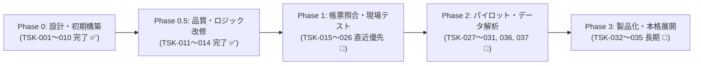

# 次世代版「らくらく営農日誌 Next」総合ToDo管理リスト・開発ロードマップ

本ドキュメントは、初期要件定義・プロトタイプ構築（Phase 0）、ロジック・品質改善改修（Phase 0.5）、および今後の現場テストから実運用・製品化（Phase 1〜3）までの全タスクを、**タスクID（`TSK-xxx`）・カテゴリーID（`CAT-xx`）・種類ID（`TYP-xx`）** 付きの管理台帳として体系化したものです。

---

## 1. ID体系（コード定義マスタ）

### 1.1 カテゴリーID（`CAT-xx`：機能・対象領域分類）
| カテゴリーID | カテゴリー名称 | 対象領域・説明 |
| :--- | :--- | :--- |
| **`CAT-01`** | **企画・DB設計** | 要件定義、データモデル（ER図）、面積按分・NPK計算アルゴリズム設計 |
| **`CAT-02`** | **フロントエンド (PWA)** | スマホ現場入力UI、オフライン永続化（LocalStorage / Service Worker）、マスタ管理 |
| **`CAT-03`** | **GIS・GPS連携** | 圃場ポリゴンマップ、作業進捗ヒートマップ、実GPS測位サジェスト、圃場カルテ |
| **`CAT-04`** | **営農計算・安全管理** | 面積比率按分、肥料NPK積算、農薬希釈逆算、農薬安全基準（使用回数・PHI）、収穫反収計算 |
| **`CAT-05`** | **A4帳票・出力連携** | JA提出用生産履歴記帳簿、作業日報、反収×NPK経営分析表、PDF/印刷出力 |
| **`CAT-06`** | **バックエンド (GAS)** | Googleスプレッドシート自動構築、未処理ログ一括按分、クラウド同期API（`doPost`/`doGet`） |
| **`CAT-07`** | **Excel・VBA連携** | デスクトップExcel用CSV取込マクロ、`M_圃場マスタ`連動按分展開、A4横PDF一発出力 |
| **`CAT-08`** | **データ移行・外部連携** | アグリノート / KSAS / eMAFF筆ポリゴン (GeoJSON) / 既存Excelからの単位換算インポート |
| **`CAT-09`** | **現場検証・運用展開** | 帳票現物照合、テスト農家データ投入、中山間地フィールドテスト、製品パッケージ化 |
| **`CAT-10`** | **データ解析・AI診断** | 回帰分析、クラスタリング、最適施肥（収穫逓減）曲線、圃場ポートフォリオ、異常値検知 |

### 1.2 種類ID（`TYP-xx`：タスク種別分類）
| 種類ID | 種類名称 | 説明 |
| :--- | :--- | :--- |
| **`TYP-REQ`** | **要件・設計** | 仕様策定、DBテーブル設計、帳票フォーマット定義、技術検証・選定 |
| **`TYP-DEV`** | **新規実装** | 画面・機能・スクリプト・マクロ・テンプレートの新規開発 |
| **`TYP-BUG`** | **不具合修正** | 計算ロジック不備、ハードコード解消、パース不具合、二重計上などのバグ修正 |
| **`TYP-ENH`** | **機能改善・拡張** | 既存機能のUX向上、操作ミス防止（取消/復元）、パフォーマンス最適化、外部連携強化 |
| **`TYP-TST`** | **検証・テスト** | 実データ投入、現地フィールドテスト、オフライン同期テスト、帳票出力照合 |
| **`TYP-OPS`** | **運用・展開** | ドキュメント整備、導入セットアップ、パッケージ化、顧客移行支援 |

---

## 2. 全タスク管理一覧（完了済み ＋ 今後のToDo）

### ✅ Phase 0：基本設計・初期プロトタイプ構築（完了済み）

| 状態 | タスクID | カテゴリーID | 種類ID | フェーズ | タスク名称・実装内容 | 対象ファイル・成果物 |
| :---: | :--- | :--- | :--- | :---: | :--- | :--- |
| `[x]` | **`TSK-001`** | `CAT-01` 企画・DB設計 | `TYP-REQ` 要件・設計 | Phase 0 | **基本方針・要件定義・統合DB設計（11テーブルER図・面積按分仕様）の策定** | `docs/requirements_and_db_design.md` |
| `[x]` | **`TSK-002`** | `CAT-01` 企画・DB設計 | `TYP-REQ` 要件・設計 | Phase 0 | **ノーコード試作ツール比較選定（AppSheet vs Glide vs PWA）とA4帳票出力仕様の策定** | `docs/prototype_and_report_spec.md` |
| `[x]` | **`TSK-003`** | `CAT-01` 企画・DB設計 | `TYP-DEV` 新規実装 | Phase 0 | **初期マスタ・日誌トランザクション・按分明細の5種CSVテンプレート作成** | `templates/01_M_FIELDS.csv` 〜 `05_T_LOG_FIELDS.csv` |
| `[x]` | **`TSK-004`** | `CAT-02` PWAフロント | `TYP-DEV` 新規実装 | Phase 0 | **現場ファーストUI（1作業×複数圃場一括登録・前回プリセット）＆ 完全オフラインPWA基盤実装** | `index.html`, `manifest.json`, `sw.js` |
| `[x]` | **`TSK-005`** | `CAT-04` 営農計算・安全 | `TYP-DEV` 新規実装 | Phase 0 | **肥料NPK自動積算・農薬希釈逆算電卓・収穫反収（俵/kg）自動按分プレビューの実装** | `index.html` |
| `[x]` | **`TSK-006`** | `CAT-03` GIS・GPS連携 | `TYP-DEV` 新規実装 | Phase 0 | **GIS圃場区画マップ・作業工程別ヒートマップ・圃場別詳細カルテ画面の実装** | `index.html` |
| `[x]` | **`TSK-007`** | `CAT-02` PWAフロント | `TYP-DEV` 新規実装 | Phase 0 | **農機具アワーメーター自動加算・点検完了記録 ＆ 肥料/農薬リアルタイム在庫引落・入庫補充の実装** | `index.html` |
| `[x]` | **`TSK-008`** | `CAT-05` A4帳票・出力 | `TYP-DEV` 新規実装 | Phase 0 | **3大A4完成帳票（①JA生産履歴記帳簿、②作業日報・按分表、③反収×NPK×労働時間総括表）の実装** | `index.html` |
| `[x]` | **`TSK-009`** | `CAT-06` GASバックエンド | `TYP-DEV` 新規実装 | Phase 0 | **Googleスプレッドシート×GAS 初期シート一括構築・未処理日誌自動按分・A4 PDF出力・PWA同期API作成** | `gas/Code.gs`, `docs/pwa_and_gas_setup_guide.md` |
| `[x]` | **`TSK-010`** | `CAT-08` データ移行 | `TYP-DEV` 新規実装 | Phase 0 | **他社アプリ（アグリノート / KSAS / eMAFF筆ポリゴンGeoJSON）からの面積単位自動換算インポーター作成** | `index.html`, `gas/Code.gs`, `migration_samples/*` |

---

### ✅ Phase 0.5：コード精査による重要ロジック改修・バグ修正（今回完了分）

| 状態 | タスクID | カテゴリーID | 種類ID | フェーズ | タスク名称・改修内容 | 対象ファイル・関数 |
| :---: | :--- | :--- | :--- | :---: | :--- | :--- |
| `[x]` | **`TSK-011`** | `CAT-03` GIS・GPS連携 | `TYP-BUG` 不具合修正 | Phase 0.5 | **【PWA】実GPS測位時の固定圃場ハードコード解消 ＆ 直線距離順（半径250m以内／同一団地）動的フィルタリング選択への改修** | `index.html` (`selectNearestFieldsByCoord_`, `detectGpsNearestFields`) |
| `[x]` | **`TSK-012`** | `CAT-04` 営農計算・安全 | `TYP-BUG` 不具合修正 | Phase 0.5 | **【PWA】農薬安全基準チェックへの「収穫前日数（PHI: `収穫予定日 - 作業日 < phiDays`）」判定ロジック追加 ＆ 違反時の登録ブロック実装** | `index.html` (`recalculatePreview`, `submitUnifiedWorkLog`) |
| `[x]` | **`TSK-013`** | `CAT-05` A4帳票・出力 | `TYP-BUG` 不具合修正 | Phase 0.5 | **【PWA & GAS】JA提出用「生産履歴記帳簿」の品種別・団地/圃場別フィルタ追加 ＆ 面積加重平均による作期累計NPK算出（二重計上防止）** | `index.html` (`renderReportsTab`), `gas/Code.gs` (`onEdit`, `refreshA4ReportSheet`) |
| `[x]` | **`TSK-014`** | `CAT-07` Excel・VBA | `TYP-BUG` 不具合修正 | Phase 0.5 | **【Excel VBA】`M_圃場マスタ` シート自動生成と面積比率（`area_ratio`）按分ロジックへの改修 ＆ ダブルクォーテーション内カンマ対応CSVパーサー実装** | `excel_vba/RakurakuEinouMacro.bas` (`EnsureFieldMasterSheet`, `AllocateMultiFieldLogs`, `ParseCsvLine`) |

---

### 🎯 Phase 1：操作性ブラッシュアップ・実帳票照合・現場フィールドテスト（直近優先 ToDo）

#### 1-A. アプリ・バックエンドの実運用ブラッシュアップ（開発系ToDo）
| 状態 | タスクID | カテゴリーID | 種類ID | 優先度 | タスク名称・実装内容 | 対象ファイル |
| :---: | :--- | :--- | :--- | :---: | :--- | :--- |
| `[x]` | **`TSK-015`** | `CAT-02` PWAフロント | `TYP-ENH` 機能改善 | **高** | **作業日誌の「取消・削除（在庫・機械アワー・累計NPKの自動ロールバック）」機能の実装** 現場での誤登録時にワンタップで直前の記録を取り消し、引き落とされた在庫や加算されたアワー・NPKを元に戻す。（実装完了 ✅） | `index.html`, `js/app.js` |
| `[x]` | **`TSK-016`** | `CAT-02` PWAフロント | `TYP-ENH` 機能改善 | **高** | **JSONバックアップファイルの「復元（インポート）」ボタンの実装** 「全データをJSONバックアップ保存」で出力したJSONファイルを読み込み、端末間移行やデータ復元を完結させる。（実装完了 ✅） | `index.html`, `js/app.js` |
| `[x]` | **`TSK-017`** | `CAT-02` PWAフロント | `TYP-ENH` 機能改善 | **中** | **「新規農薬マスタ」「新規機械マスタ」の画面上からの追加登録フォーム実装** 既存の圃場・肥料追加フォームに加え、現場で新しい農薬（登録番号・PHI・使用回数上限）や農機具を追加できるようにする。（実装完了 ✅） | `index.html`, `js/app.js` |
| `[x]` | **`TSK-018`** | `CAT-03` GIS・GPS連携 | `TYP-ENH` 機能改善 | **中** | **新規追加・他社移行圃場（GeoJSON等）のSVGマップ動的ポリゴン/ピン描画 ＆「収穫」ヒートマップ追加** `F01`〜`F07`以外の追加圃場もマップ上に視覚表示し、ID採番を2桁ゼロ埋め（`F08`, `F09`, `F10`）に統一する。（実装完了 ✅） | `index.html`, `js/app.js` |
| `[ ]` | **`TSK-019`** | `CAT-06` GASバックエンド | `TYP-ENH` 機能改善 | **中** | **GAS `processPendingLogs()` のバッチ書き込み高速化 ＆ `doPost` 重複排除・`doGet` マスタ取得実装** セル単位の `setValue` を配列一括更新（`setValues`）に最適化し、未同期0件時の重複送信防止とクラウドからのマスタ取得を実装する。 | `gas/Code.gs`, `index.html` |
| `[ ]` | **`TSK-020`** | `CAT-02` PWAフロント | `TYP-ENH` 機能改善 | **低** | **データの大量蓄積に備えた `localStorage` から `IndexedDB` へのストレージ拡張** 数年分の作業履歴や複雑なGeoJSONポリゴン座標を保存しても容量制限（5MB）に達しないよう永続化層を拡張する。 | `index.html` |

#### 1-B. 実帳票フォーマット照合・現地フィールド検証（運用・テスト系ToDo）
| 状態 | タスクID | カテゴリーID | 種類ID | 優先度 | タスク名称・実施内容 | 対象・担当 |
| :---: | :--- | :--- | :--- | :---: | :--- | :--- |
| `[ ]` | **`TSK-021`** | `CAT-05` A4帳票・出力 | `TYP-REQ` 要件・設計 | **最高** | **提出先JAの「生産履歴記帳簿（施肥・防除）」現物フォーマット（Excel/PDF/紙）回収と項目照合** 種子消毒欄、土壌改良資材欄、特別栽培米区分、対象病害虫名など、地域JA固有の必須記載項目を洗い出す。 | 企画・現場担当 |
| `[ ]` | **`TSK-022`** | `CAT-05` A4帳票・出力 | `TYP-REQ` 要件・設計 | **高** | **行政交付金（中山間直接支払・環境保全型農業）・GAP監査用フォーマットの回収と照合** 交付金申請やJGAP/ASIAGAP審査で求められる作業日報・機械整備記録・資材受払簿の必須項目を確認する。 | 企画・現場担当 |
| `[ ]` | **`TSK-023`** | `CAT-05` A4帳票・出力 | `TYP-ENH` 機能改善 | **高** | **回収した実物フォーマットに合わせた PWA / GAS / Excel VBA のA4印刷レイアウト微調整** `TSK-021`・`TSK-022`で回収した現物様式の罫線・列順・ヘッダ項目に100%一致するよう出力テンプレートを調整する。 | `index.html`, `Code.gs`, `RakurakuEinouMacro.bas` |
| `[ ]` | **`TSK-024`** | `CAT-08` データ移行 | `TYP-TST` 検証・テスト | **高** | **テスト農家の実圃場データ（eMAFF筆ポリゴン / 旧日誌）および地域防除暦（農薬・肥料マスタ）の初期投入** 実在の田んぼリストと、地元JAの「水稲栽培ごよみ」記載の農薬・肥料をプリセット登録する。 | 現場テスト環境 |
| `[ ]` | **`TSK-025`** | `CAT-09` 現場検証・展開 | `TYP-TST` 検証・テスト | **高** | **現場オペレーター（高齢作業者含む）による片手操作・直射日光下での視認性テスト** トラクター乗車前後や屋外にて、「前回と同じ」呼び出しから登録完了まで10秒以内で迷わず操作できるか検証する。 | 現地圃場テスト |
| `[ ]` | **`TSK-026`** | `CAT-09` 現場検証・展開 | `TYP-TST` 検証・テスト | **高** | **中山間地（電波圏外エリア）でのオフライン連続記録 ＆ 帰宅後のGoogleスプレッドシート同期テスト** 圏外環境で複数筆の作業を記録し、電波復帰後に欠損や重複なくGASへ同期・面積按分されることを実証する。 | 現地圃場テスト |

---

### 🚀 Phase 2：パイロット運用・現場省力化＆データ解析の強化（1〜2ヶ月目 ToDo）

| 状態 | タスクID | カテゴリーID | 種類ID | 優先度 | タスク名称・実装内容 |
| :---: | :--- | :--- | :--- | :---: | :--- |
| `[x]` | **`TSK-027`** | `CAT-03` GIS・GPS連携 | `TYP-ENH` 機能改善 | **高** | **実航空写真タイル（Google衛星画像・国土地理院）＋ Leaflet による実ポリゴン重畳＆田んぼ囲み自動測量（実装完了 ✅）** |
| `[ ]` | **`TSK-036`** | `CAT-10` データ解析 | `TYP-DEV` 新規実装 | **高** | **【データ解析①】チッソ(N)施肥量 × 反収の二次曲線回帰（収穫逓減カーブ）＆ 最適施肥量（ピーク値）自動算出ダッシュボード** 最小二乗法による二次関数フィット（$y = ax^2 + bx + c$）を用いて、各圃場のチッソ施肥量と反収（kg/10a）の相関散布図を描画。最も反収・粗利が高くなる頂点の最適チッソ量を自動算出し、過剰施肥／不足圃場のアラートを出力。 |
| `[ ]` | **`TSK-037`** | `CAT-10` データ解析 | `TYP-DEV` 新規実装 | **高** | **【データ解析②】全圃場の4象限ポートフォリオ解析（10aあたり粗利益 × 10aあたり作業時間バブルチャート ＆ 4グループ自動クラスタリング）** 横軸に「10aあたり作業・機械時間（手間の少なさ）」、縦軸に「10aあたり粗利益（収益性）」、バブルサイズに「圃場面積」をとったインタラクティブマトリクス。全圃場を「🌟優良主力田」「🔧改善余地田」「💦労力過多田」「⚠️要見直し田」の4グループに自動分類し、経営改善のアクションを提示。 |
| `[ ]` | **`TSK-028`** | `CAT-02` PWAフロント | `TYP-DEV` 新規実装 | **中** | **スマホカメラによる農薬ボトル・肥料袋の「JANバーコード / QRコード読み取り」自動資材選択機能** |
| `[ ]` | **`TSK-029`** | `CAT-02` PWAフロント | `TYP-DEV` 新規実装 | **中** | **音声入力補助（「本場1号から3号まで草刈り2時間」と話すだけでフォームを自動セットする機能）の検証・実装** |
| `[ ]` | **`TSK-030`** | `CAT-04` 営農計算・安全 | `TYP-ENH` 機能改善 | **中** | **FAMIC（農林水産消費安全技術センター）農薬登録情報との連携による適用基準（使用回数・収穫前日数）自動更新** |
| `[ ]` | **`TSK-031`** | `CAT-06` GASバックエンド | `TYP-DEV` 新規実装 | **高** | **複数スタッフ間のリアルタイム作業指示・進捗共有（管理者が朝にマップで対象圃場を指定→作業者が完了タップで即時共有）** |

---

### 🏢 Phase 3：製品化・既存「らくらく営農日誌」ユーザー本格展開（3ヶ月目〜 ToDo）

| 状態 | タスクID | カテゴリーID | 種類ID | 優先度 | タスク名称・実装内容 |
| :---: | :--- | :--- | :--- | :---: | :--- |
| `[ ]` | **`TSK-032`** | `CAT-08` データ移行 | `TYP-OPS` 運用・展開 | **最高** | **現行「らくらく営農日誌」既存顧客向け ワンクリックデータ移行ツール（圃場・過去履歴・機械マスタ）のパッケージ化** |
| `[ ]` | **`TSK-033`** | `CAT-06` GASバックエンド | `TYP-DEV` 新規実装 | **高** | **マルチデバイス認証・クラウド自動バックアップ基盤（Google Workspace / Firebase / Supabase等）の構築** |
| `[ ]` | **`TSK-034`** | `CAT-05` A4帳票・出力 | `TYP-DEV` 新規実装 | **中** | **集落営農・認定農業者グループ向け JA生産履歴記帳簿の「地域・複数農家一括出力・電子提出」機能** |
| `[ ]` | **`TSK-035`** | `CAT-09` 現場検証・展開 | `TYP-OPS` 運用・展開 | **高** | **株式会社セーブ正式製品版としての導入マニュアル・操作動画・サポート体制の整備** |

---

## 3. 進捗サマリー（現在地）

- **全登録タスク数**: **37 件**（`TSK-001` 〜 `TSK-037`）
  - **完了済み（Phase 0 / 0.5 / 1 / 2）**: **19 件**（`TSK-001`〜`018`, `TSK-027` ✅）
  - **直近着手（Phase 1：実証・照合検証）**: **8 件**（`TSK-019` 〜 `TSK-026` 🎯）
  - **中期（Phase 2：データ解析・パイロット機能拡張）**: **6 件**（`TSK-028`〜`031`, **`TSK-036`**, **`TSK-037`** 📊）
  - **長期（Phase 3：製品化・本格展開）**: **4 件**（`TSK-032` 〜 `TSK-035` 🏢）
